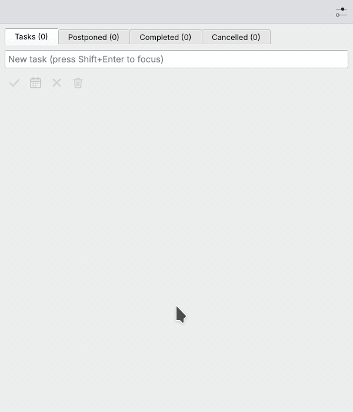

# todo-ubuntu-kde



A simple todo list for KDE Plasma 5 (Qt Quick + Kirigami, KDE Frameworks 5).
Todos are kept in a JSON text file, `todos.json`, in a folder of your choice
(your home directory by default; change it with *Settings* → *Storage folder*).

## Using it

- **Add a task** – click the input above the list (or press `Shift+Enter` while nothing is highlighted),
  type and press `Enter`; the new task appears on top. In the input, `Shift+Enter` starts the description.
- **Highlight** – one click highlights a task; `Up` / `Down` move the highlight, `Esc` removes it.
  `Space` ticks the highlighted task, `Shift+Up` / `Shift+Down` tick the tasks the highlight passes.
- **Task card** – double-click a task (or press `Enter` / `Shift+Enter` on the highlighted one) to see and edit
  title, description and labels, or to complete, postpone or cancel the task.
- **Quick complete** – hover a task and click the green checkmark at the end of its line.
- **Select** – tick the checkbox of one or more tasks (`Ctrl+A` ticks all), then use the buttons
  between the input and the list (each tab shows only the buttons that apply to it):
  *Complete* (green checkmark), *Postpone* (calendar), *Cancel task* (gray cross), *Delete* (red bin)
  and *Restore* (arrow). The buttons show only icons; hover one to see its name.
  With nothing ticked, they act on the highlighted task. In a dark colour scheme the calendar and
  the cross turn light; the checkmark stays green and the bin red.
  Deleting several tasks at once asks for confirmation; deletion is permanent.
- **Postpone** – until tomorrow, 3 days, 1 week, 1 month or a custom date and time.
  A postponed task returns to the list at that time while the app runs (also in the tray),
  or when the app is opened next. It then shows a yellow alarm icon until you click the icon
  or the task changes its state; the icon is kept when the app is closed and reopened.
- **Tabs** – *Tasks*, *Postponed*, *Completed*, *Cancelled*.
- **Reorder** – drag a task by its handle, or `Ctrl+Up` / `Ctrl+Down` on the highlighted task.
- **Labels** – *Settings* → *Labels* defines labels (name + one of 12 colors).
  Assign them in the task card, or tick tasks and click a label above the list.
  With nothing ticked, clicking a label filters the lists
  (a task is shown if it has any of the selected labels).

## Tray icon

While the app runs it has an icon in the system tray. Click it for a popup with the first 5 tasks
of the Tasks list (each can be completed with its checkmark) and an *Open Todo* button.
The popup leaves the app's window as it is (it is not raised and does not get the focus) until you
click *Open Todo*; a click outside the popup or `Esc` closes it.
Closing the window keeps the app running in the tray; quit with `Ctrl+Q` or *Quit* in the
icon's context menu. Only one instance runs: starting the app again brings its window to the front.

## Terminal output

Started from a terminal, the app prints only its own critical errors. Debug and warning lines of the
Qt and KDE libraries are dropped; set `QT_LOGGING_RULES` (for example `QT_LOGGING_RULES='*.debug=true'`)
to see all of them again.

## Keyboard shortcuts

The list is also in the app: *Settings* (the button at the right end of the toolbar) → *Keyboard shortcuts*.
"Selected" means the ticked tasks or, when none is ticked, the highlighted task.

| Key | Action |
| --- | --- |
| `Shift+Enter` | Nothing highlighted: start typing a new task (the only key way into the input). Task highlighted: open its card |
| `Enter` | In the input: create the task. Task highlighted: open its card |
| `Shift+Enter` in the input | New line: the description follows the title |
| `Esc` | Leave the input and remove the highlight |
| `Esc` `Esc` | Pressed twice quickly: untick all tasks |
| `Up` / `Down` | Move the highlight |
| `Shift+Up` / `Shift+Down` | Move the highlight and tick the tasks it passes (never unticks) |
| `Space` | Tick or untick the highlighted task |
| `Ctrl+Up` / `Ctrl+Down` | Move the highlighted task up / down in the list |
| `Ctrl+PgDown` / `Ctrl+PgUp` | Next / previous tab (wraps around) |
| `Ctrl+A` | Tick all tasks of the current tab |
| `Ctrl+D` | Duplicate the selected tasks (copies go to the bottom of the Tasks list) |
| `Shift+Delete` | Delete the selected tasks for good (several at once ask first) |
| `K` | Complete the selected tasks (can be changed) |
| `Del` | Cancel the selected tasks (can be changed) |
| `P` | Postpone the selected tasks: opens the menu asking for how long (can be changed) |
| `R` | Restore the selected tasks (can be changed) |
| `Enter` in the task card title | Save and close the card |
| `Ctrl+Q` | Quit |

### Your own shortcuts

The last four rows (complete, cancel, postpone, restore) can be changed: open *Settings* → *Keyboard shortcuts*,
click the shortcut of an action and press the key or combination you want (`Esc` gives up). A key that is
already used is refused and the message says what uses it: the keys of the other shortcuts, and the fixed ones
in the table above, cannot be taken. The cross next to a shortcut removes it, the arrow puts back its default
without touching the others. The shortcuts are saved in the todo file, `todos.json`, together with your tasks and labels: copy or move that
file and they come along, and a todo file without shortcuts uses the defaults. The only thing the app keeps
outside it is the folder where the todo file is (in `~/.config/kdetodorc`). Like the other task keys, these work
while the task list has the keyboard focus, not while you type in the new-task input.

At start nothing is highlighted and the input does not have the focus: the keys go to the task list.
Clicking a task also gives the keys to the list. In the empty input, `Up` / `Down` go back to the list.

## Install

Releases are on the [Releases](https://github.com/anjankow/todo-ubuntu-kde/releases) page
(made with *Actions → Release → Run workflow* on `main`).

- `scripts/install-deb.sh [latest | <version>]` – downloads the Debian package and installs it with apt.
- `scripts/run-appimage.sh [latest | <version>]` – downloads the AppImage and starts it; nothing is installed.
- `scripts/run-latest-build.sh` – runs the binary CI built for the latest merge to `main` (needs `gh`, signed in).

## Build

```bash
sudo apt install build-essential cmake ninja-build extra-cmake-modules \
    qtbase5-dev qtdeclarative5-dev qtquickcontrols2-5-dev \
    libkf5coreaddons-dev libkf5i18n-dev libkf5config-dev libkf5dbusaddons-dev \
    qml-module-qtquick2 qml-module-qtquick-window2 qml-module-qtquick-controls2 \
    qml-module-qtquick-templates2 qml-module-qtquick-layouts qml-module-qt-labs-platform \
    qml-module-org-kde-kirigami2 qml-module-org-kde-qqc2desktopstyle
```

```bash
cmake -S . -B build -G Ninja -DCMAKE_BUILD_TYPE=Release
```

```bash
cmake --build build
```

```bash
QT_QPA_PLATFORM=offscreen QT_QUICK_BACKEND=software ctest --test-dir build --output-on-failure
```

```bash
sudo cmake --install build
```

Run it with `kdetodo` (or `./build/bin/kdetodo` without installing).
